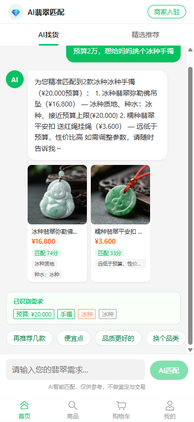
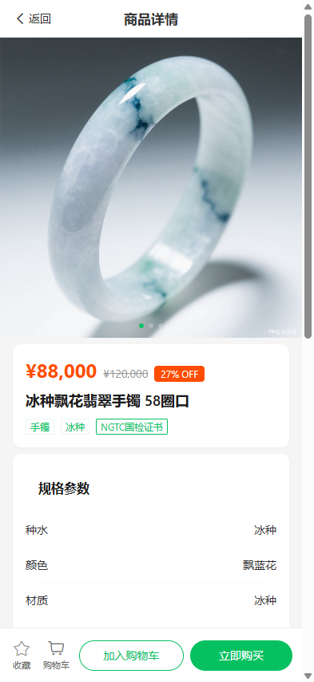
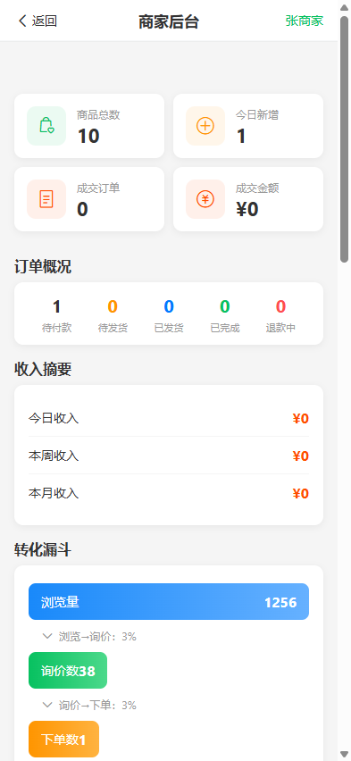

# 翡翠商城 (Jadeite Mall)

> AI 驱动的翡翠电商全栈项目：C 端 AI 找货与交易、B 端商家经营，Vue 3 + Vant 前端，Express + SQLite 后端。

   

|                                   首页 · AI 找货                                   |                                      商品详情                                       |                                 我的订单                                  |                                     商家看板                                     |
| :--------------------------------------------------------------------------------: | :---------------------------------------------------------------------------------: | :-----------------------------------------------------------------------: | :------------------------------------------------------------------------------: |
|  |  |  |  |

## 功能特性

- **AI 找货**：用一句话描述预算、种水、偏好，加权评分匹配在售商品并给出匹配分与需求识别标签，可追问"再推荐几款 / 便宜点 / 品质更好的"。
- **C 端商城**：商品列表/详情（含 NGTC 鉴定证书信息）、购物车、下单支付、订单状态跟踪、退款申请、收货地址簿、收藏与商品对比。
- **B 端商家后台**：商品发布与上下架、订单处理（发货/确认收款/退款审批）、客户管理、经营看板（订单概况、收入摘要、转化漏斗）。
- **完整订单状态机**：待付款 → 待发货 → 待收货 → 已完成，支持取消回补库存与退款双向流转（申请/批准/拒绝）。
- **真实后端**：Express 5 + SQLite 落库，JWT 鉴权、幂等下单、库存事务与角色隔离，前端经 `/api` 代理直连。

## 快速开始

需 Node ≥ 20。

```bash
# 终端 1：后端（Express + better-sqlite3，监听 :3001）
cd server && npm install && npm run dev

# 终端 2：前端（Vite :5173，/api 已代理到 :3001）
npm install
npm run dev
```

登录：手机号任意（未注册自动注册为买家），验证码填万能码 `1234`；开发模式点"发送验证码"会弹窗展示后端生成的短信验证码。商家账号为 seed 的 `138 8888 6666`（M001）。

## 环境变量

| 变量                                             | 默认   | 说明                          |
| ------------------------------------------------ | ------ | ----------------------------- |
| `VITE_API_BASE_URL`                              | `/api` | 后端接口前缀                  |
| 服务端 `PORT` / `JWT_SECRET` / `ALLOWED_ORIGINS` | —      | 见 [docs/env.md](docs/env.md) |

## 测试

```bash
npm run test                 # 单元测试（vitest）
npm run test:e2e             # 端到端测试（playwright，自动拉起前后端与独立测试库）
npm run lint && npm run lint:style
cd server && npm run test    # 后端冒烟测试（自起 :3101）
```

## 构建与部署

```bash
npm run build      # 产物 dist/，含 PWA service worker
npm run preview    # 本地预览 :4173
```

<details>
<summary>Nginx 参考配置（SPA + API 反代）</summary>

```nginx
server {
    listen 80;
    root /var/www/jadeite-mall/dist;
    location / { try_files $uri $uri/ /index.html; }
    location /api/ { proxy_pass http://127.0.0.1:3001; }
}
```

</details>

## 项目结构

<details>
<summary>目录树</summary>

```text
├── src/                  # 前端（Vue 3 + Pinia + Vant 4）
│   ├── api/              # 接口层：REST 封装与错误契约
│   ├── components/       # 11 个共享组件
│   ├── pages/            # 24 个页面（C 端 + 商家后台）
│   ├── stores/           # Pinia 状态（user/product/cart/order/address）
│   ├── data/             # B 端演示数据（商家/客户/看板）
│   └── utils/            # aiMatch 加权匹配、格式化、图片
├── server/               # 后端（Express 5 + better-sqlite3）
│   ├── src/routes/       # auth / products / orders / addresses
│   ├── src/data/         # 商品 seed 数据
│   └── src/smoke.ts      # 冒烟测试
└── docs/                 # 设计文档与截图
```

</details>

## 文档

- [docs/backend-design.md](docs/backend-design.md) — 后端设计、接口契约与错误码
- [docs/env.md](docs/env.md) — 环境变量说明
- [src/api/README.md](src/api/README.md) — API 层接线说明

## 贡献

欢迎提 Issue 与 PR；提交前请跑通上方"测试"一节。

## 许可证

UNLICENSED — 私有演示项目，仅供学习交流。
